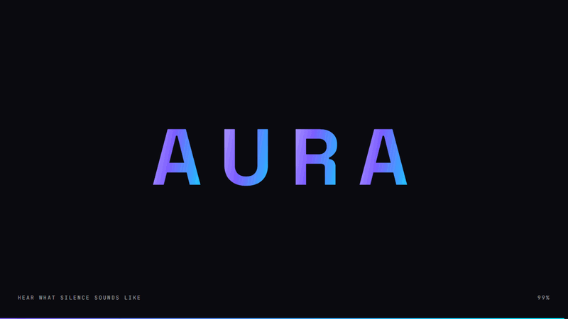

# AURA One — concept launch page

A scroll-driven product launch page for fictional wireless earbuds, designed in Claude Design and built with React, TypeScript and Three.js.

**Live:** https://aura-one-earbuds.vercel.app



## Highlights
- **3D product** — the earbuds are modelled in code with Three.js (React Three Fiber): they float, tilt with the cursor, turn as you scroll, and can be dragged around in the finish section
- **Live noise-cancelling demo** — a city street generated in real time with the Web Audio API; switching ANC on sweeps a low-pass filter down and the spectrum analyser shows the noise disappear
- **Finish picker** — one click re-tints the 3D model *and every glow, gradient and button on the page* (tweened CSS custom properties)
- **Scroll storytelling** — pinned scenes (GSAP ScrollTrigger): the charging case opens step by step, an exploded view separates four layers, a gallery scrolls sideways with inner image parallax
- **Details** — intro loader, character-staggered headline, count-up stats, cursor spotlight cards, magnetic buttons, custom cursor, smooth scrolling (Lenis)
- **Responsive & accessible** — phone layouts for every section, keyboard focus styles, semantic markup, and `prefers-reduced-motion` turns the motion off
- **Fast** — three.js loads in a lazy chunk after first paint, 3D canvases pause when off screen, photos are ~30 kB WebP

## Stack
React 19 · TypeScript · Vite · Three.js / React Three Fiber · GSAP + ScrollTrigger · Lenis · Web Audio API · plain CSS

## Run it
```bash
npm install
npm run dev        # http://localhost:5173
npm run build      # typecheck + production build in dist/
```

## Project structure
```
src/
  App.tsx                    page assembly, smooth scroll, finish colours, magnetic buttons
  data.ts                    price, ship date, author, socials, colour finishes
  components/
    three/Earbuds3D.tsx      the 3D earbuds (hero + drag-to-rotate showcase)
    NoiseDemo.tsx            ANC demo UI + spectrum visualiser
    Hero, Reveal, Features, Exploded, Finish, Strip, Closing, Loader, Nav, Cursor
  lib/cityNoise.ts           Web Audio city-street generator
scripts/
  images.mjs                 photos/ → optimised WebP in public/images/
  og.mjs                     renders the link-preview image public/og.png
```

## Make it yours
- `src/data.ts` — price, ship date, your name, links and colour finishes
- `photos/` — swap the gallery photos, then run `npm run images`

## Credits
Gallery photos from [Unsplash](https://unsplash.com) (Unsplash License):
[gym](https://unsplash.com/photos/b_nBpRTci3U) ·
[commute](https://unsplash.com/photos/KZ2p9HbL_3I) ·
[studio](https://unsplash.com/photos/uNj9-Ex697U) ·
[travel](https://unsplash.com/photos/FZRLa2Lk7-Y)

---

Designed & built by **Saqib Niazi**. AURA is a concept project, not a real product.
